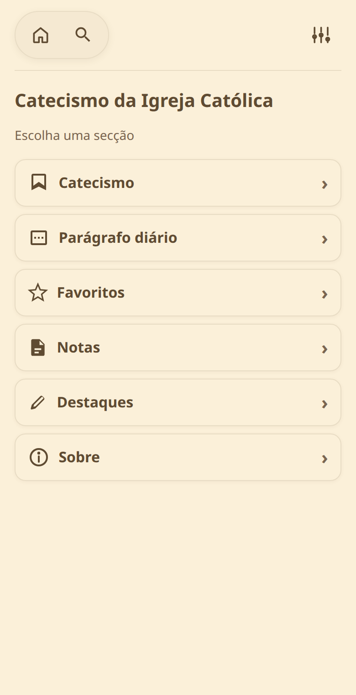
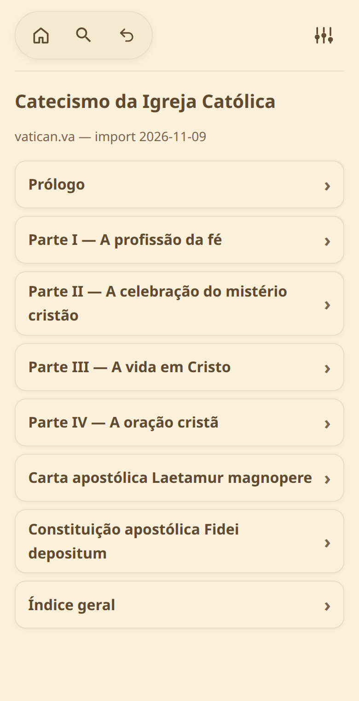
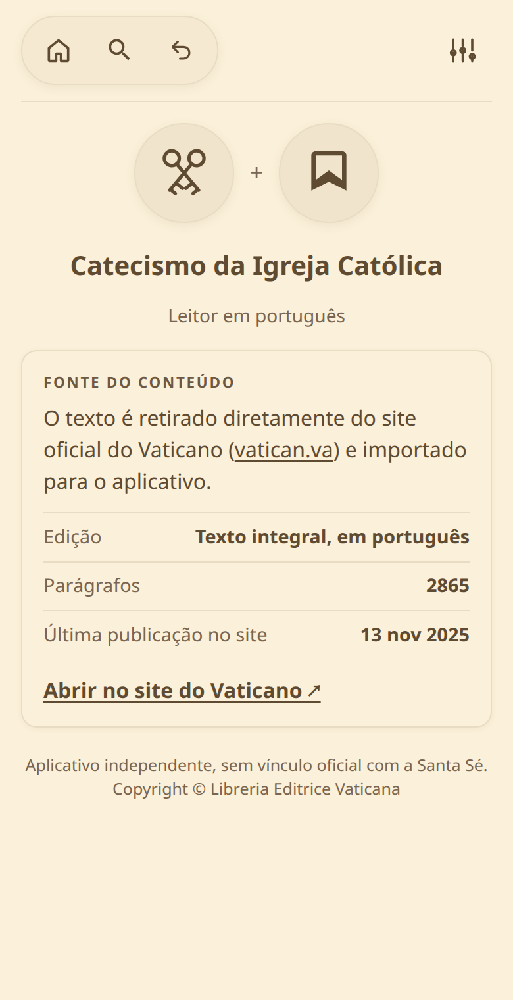

# Catecismo — leitor do CIC em português

Aplicativo Android para ler o **Catecismo da Igreja Católica** (texto integral, em português), com navegação por partes, busca e ferramentas de estudo pessoal.

> Projeto em desenvolvimento. O código-fonte é privado; esta página apresenta o aplicativo.

## Telas

| Menu principal | Navegação do Catecismo | Sobre |
|:---:|:---:|:---:|
|  |  |  |

## O que o app faz

- **Texto integral do CIC** (2865 parágrafos), com prólogo, carta apostólica, constituição apostólica e índice geral.
- **Busca** e navegação por partes, secções, capítulos e artigos.
- **Parágrafo diário** para meditar.
- **Destaques, notas e favoritos** direto no texto, ao selecionar um trecho.
- **Temas** sépia, claro e escuro, com ajuste do tamanho do texto.
- **Funciona offline**: o conteúdo fica no aparelho.

## Fonte do conteúdo

O texto é retirado do site oficial do Vaticano ([vatican.va](https://www.vatican.va/archive/ccc/index_po.htm)) e importado para o aplicativo.

## Disponibilidade

Em testes. A publicação na Google Play está prevista.

## Aviso

Aplicativo independente, sem vínculo oficial com a Santa Sé.
Texto do Catecismo: © Libreria Editrice Vaticana.
Capturas e materiais deste repositório: © 2026 Matheus Eduardo, todos os direitos reservados.
